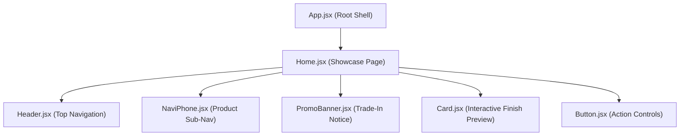

# iPhone 13 Pro Showcase (`@vitoria-rodrigues/iphone13pro-react`)

Interactive product showcase replicating the Apple iPhone 13 Pro presentation page, built with React 19 and Vite 7 with dynamic color finish switching and responsive styling.

Live deployment: [iphone13-pro-react.vercel.app](https://iphone13-pro-react.vercel.app/)

---

## 1. Technology Stack

- **UI Library**: React 19.1
- **Build Tool**: Vite 7.1
- **Language**: JavaScript (ES Modules, JSX)
- **Styling**: Modular component CSS and global resets
- **Code Quality**: ESLint 9
- **Package Management**: pnpm 10 with `catalogMode: strict`
- **Hosting**: Vercel Continuous Deployment

---

## 2. Architecture Overview

The application composes modular header, navigation, promotional banner, and interactive device showcase sections from `src/pages/Home.jsx`.



### Project Structure

```text
iphone13pro-react/
├── .agents/
│   └── plugins.json        # Antigravity plugin registry (@vitoria-rodrigues/agent-mesh)
├── src/
│   ├── assets/
│   │   └── img/            # Device finish photography and Apple vector logo
│   ├── components/         # Reusable UI components and stylesheets
│   ├── pages/
│   │   └── Home.jsx        # Main showcase page view
│   ├── App.css             # Application layout styles
│   ├── App.jsx             # Root React component
│   ├── index.css           # Global CSS resets and variables
│   └── main.jsx            # React DOM entrypoint
├── AGENTS.md               # Sovereign root context router (Layer 1)
├── eslint.config.js        # ESLint flat configuration
├── index.html              # HTML entry document
├── package.json            # Scoped manifest (@vitoria-rodrigues/iphone13pro-react)
├── pnpm-lock.yaml          # Deterministic pnpm lockfile
├── pnpm-workspace.yaml     # Centralized pnpm dependency catalogs
├── README.md               # Primary developer documentation
└── vite.config.js          # Vite bundler configuration
```

---

## 3. Getting Started

### Prerequisites

- Node.js 20 or higher
- pnpm 10 or higher

### Installation & Local Development

1. Clone the repository:

```bash
git clone https://github.com/Vitoria-Rodrigues/iphone13pro-react.git
cd iphone13pro-react
```

2. Install dependencies:

```bash
pnpm install
```

3. Start the local development server:

```bash
pnpm dev
```

---

## 4. Key Scripts

| Command | Description |
| :--- | :--- |
| `pnpm dev` | Starts the Vite development server with Hot Module Replacement (HMR). |
| `pnpm build` | Compiles production assets into the `dist/` directory. |
| `pnpm preview` | Serves the production build locally for validation. |
| `pnpm lint` | Executes ESLint across project source files. |

---

## 5. AI Agent Mesh Integration

This repository consumes organizational AI agent skills, rules, and MCP configurations via `@vitoria-rodrigues/agent-mesh` declared in `catalog:plugins-stack` ([pnpm-workspace.yaml](./pnpm-workspace.yaml)) and mounted through [.agents/plugins.json](./.agents/plugins.json).

---

## 6. Governance Standards

1. **Conventional Commits**: All commits must follow `<type>(<scope>): <description>` (v1.0.0).
2. **Cryptographic Signing**: Sign commits with SSH (`git commit -S -m "..."`) when a signing key is configured.
3. **Zero-Emoji Invariant**: Emojis are strictly prohibited in code, documentation, and commit messages.
4. **Language Policy**: Technical documentation, code, and commit messages are written strictly in en-US.
